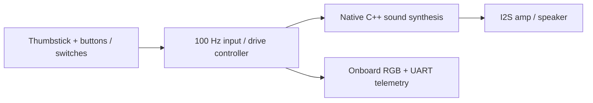

# Ignition handheld

Luke's direction: a handheld engine toy with a throttle trigger, gear buttons and switches, capable of running on an ESP. Keep both combustion and science-fiction sounds and extensive tuning controls. For the first physical build, Luke has a spring-centred thumbstick: use it as the throttle, with its click as the brake. Rotary encoders are available but are not needed for this wiring profile.

## First playable version

Builder choices: browser toy first, using the existing synthesizer. A spring-return throttle, six sequential gears plus neutral, automatic clutch, brake button, boost switch and ignition. It opens in Play; Tune retains the existing sound-design bench. Gear changes interrupt drive briefly and change engine speed relative to virtual road speed. Downshifts that would over-rev are rejected. This is an expressive toy model, not a vehicle simulator. No account, network dependency, or recordings.

The independent `ToyDrive` controller owns ignition/cranking, gear, speed, load and rev targets. The audio engine remains separate. Touch release, pointer cancellation, keyboard release, focus loss and tab hiding release momentary controls. Ignition off resets the drive. Changing Play/Tune stops audio before changing control authority. Patches stay compatible.

Implementation sequence: test the driving behavior; add the independent controller; connect the handheld controls to existing audio; rebuild the self-contained HTML; exercise controls and capture real browser audio; document the physical mapping. Preserve the startup fallback and bounded error handling.

Verification: neutral revs without motion; first accelerates; upshift drops RPM; brake slows; boost adds acceleration; invalid downshift is blocked; momentary controls always release; worklet and callback audio both produce nonzero samples; standalone needs no adjacent assets; Tune patch/export still work; all test processes exit.

## Physical layout

```text
         [ IGNITION ]       [ BOOST ]
       ┌─────────────────────────────┐
       │   RPM arc      N / 1–6      │
       │          speaker            │
       │                             │
       │     [ GEAR − ] [ GEAR + ]    │ ← thumb
       └──────────┐       ┌──────────┘
                  │ grip  │
       trigger →  ╯       │
       brake →    ●       │
                  └───────┘
```

This is an earlier interaction sketch, not an enclosure drawing. The bench version substitutes a spring-centred thumbstick for the trigger: push forward for variable throttle, release to idle, click for brake. Two buttons shift; latching toggles select ignition and boost. The onboard RGB and serial monitor provide feedback; a display is a future addition. USB power for bench testing; portable power is a separate enclosure decision.

Luke supplied a photo on 2026-11-06. The middle board is marked ESP32-S3-WROOM-1, Lonely Binary Gold Edition, and is the selected target. He authorized borrowing Iris's MAX98357A and donor speaker. See [the firmware wiring guide](../firmware/README.md) for the verified source files, amp mapping and controls. The toy S3 (USB serial 58:e6:c5:68:65:c8) has now been backed up, flashed, readback-verified and observed running over native USB. Iris and the printer display were not flashed.

## ESP implementation map

| Toy control | Electrical input | Model input |
| --- | --- | --- |
| Spring-centred thumbstick | VRy to GPIO4 ADC; centre/full calibration + dead zone, one-sided travel | `throttle`, 0–1 |
| Gear − / + | Two debounced momentary switches | One `shift(-1/+1)` per press, no autorepeat |
| Brake | Thumbstick SW click or debounced momentary switch | `brake`, held boolean |
| Ignition | Latching switch | Rising edge starts; falling edge stops |
| Boost | Latching switch | `boost`, boolean |
| Character | Optional momentary button | Cycle all eight patches |
| Volume | Constant in `board_config.h` for this build | Output gain |

Logical input budget: one analog channel and five digital inputs for the core controls, plus one optional momentary character button. The stick's unused axis stays disconnected. The implemented profile uses the onboard RGB LED and UART readout; no screen driver is included. The firmware guide assigns GPIOs against the photographed board's pinout. Do not copy the map to the classic ESP32.



The arithmetic and state machine are now ported to C++, with preallocated buffers and a separate audio task. The browser remains the patch editor. Audio target: 32 kHz synthesis, duplicated mono in 32-bit stereo I²S slots (matching Iris's proven slot format), 128-sample blocks. A block lasts 4 ms; firmware reports generation time and misses against that deadline. The 27 ms reflection delay uses 864 floats = 3,456 bytes. A mono float block plus a stereo int32 block uses 1,536 bytes, excluding driver buffers and stacks. Test the reduced sample rate for sound quality on hardware; browser audio remains 48 kHz.

The synth uses procedural pulses, noise, filters and oscillators rather than sample recordings, plus interpolated sine/saturation tables for the native audio loop. Radios are not initialized. Ignition off fades to silence; startup requires released throttle and a fresh ignition edge after observing off. Native tests and an ESP32-S3 compilation pass. Real-time board performance has not yet been measured.

Espressif's [Arduino I2S API](https://docs.espressif.com/projects/arduino-esp32/en/latest/api/i2s.html) supports configurable clock/data pins and PCM output. Its [ADC documentation](https://docs.espressif.com/projects/arduino-esp32/en/latest/api/adc.html) describes analog reads and notes that channels, pins and voltage ranges differ by chip. The selected output stage is Iris's [MAX98357A I2S amplifier](https://learn.adafruit.com/adafruit-max98357-i2s-class-d-mono-amp/overview) and donor speaker, temporarily borrowed for this build and powered from USB 5 V. Sources checked 2026-11-06.

Full hardware acceptance requires the identified board, actual input controls and an audio capture from its output: stable block timing, working stick centre/full travel, one shift per press, no held input after release, audible ignition/shift/boost changes and clean shutdown. Flash, boot, centred-stick zero throttle and silent-block I²S activity have been verified. **Physical sound and the full control sequence are unverified — need user confirmation and a physical bench test.** See `verification.md` for measured results.
