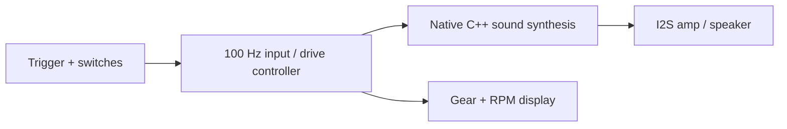

# Ignition handheld

Luke's direction: a handheld engine toy with a throttle trigger, gear buttons and switches, capable of running on an ESP. Keep both combustion and science-fiction sounds and extensive tuning controls.

## First playable version

Builder choices: browser toy first, using the existing synthesizer. A spring-return throttle, six sequential gears plus neutral, automatic clutch, brake button, boost switch and ignition. It opens in Play; Tune retains the existing sound-design bench. Gear changes interrupt drive briefly and change engine speed relative to virtual road speed. Downshifts that would over-rev are rejected. This is an expressive toy model, not a vehicle simulator. No account, network dependency, or recordings.

The independent `ToyDrive` controller owns ignition/cranking, gear, speed, load and rev targets. The audio engine remains separate. Touch release, pointer cancellation, keyboard release, focus loss and tab hiding release momentary controls. Ignition off resets the drive. Changing Play/Tune stops audio before changing control authority. Patches stay compatible.

Implementation sequence: test the driving behavior; add the independent controller; connect the handheld controls to existing audio; rebuild the self-contained HTML; exercise controls and capture real browser audio; document the physical mapping. Preserve the startup fallback and bounded error handling.

Verification: neutral revs without motion; first accelerates; upshift drops RPM; brake slows; boost adds acceleration; invalid downshift is blocked; momentary controls always release; worklet and callback audio both produce nonzero samples; standalone needs no adjacent assets; Tune patch/export still work; all test processes exit.

## Physical layout

```text
         [ IGNITION ]       [ BOOST ]
       ┌─────────────────────────────┐
       │   RPM arc      N / 1–6      │
       │          speaker            │
       │                             │
       │     [ GEAR − ] [ GEAR + ]    │ ← thumb
       └──────────┐       ┌──────────┘
                  │ grip  │
       trigger →  ╯       │
       brake →    ●       │
                  └───────┘
```

This is an interaction sketch; enclosure dimensions await the actual board, trigger and speaker. A spring-loaded analog trigger provides variable throttle. A thumb rocker or two buttons shifts. A second momentary button brakes. Latching toggles select ignition and boost. A small display or LED arc reports RPM, gear and shift refusal. USB power for bench testing; portable power is a separate enclosure decision.

Board and pins are pending Luke's board choice. Existing sensor-lab notes mention ESP32 boards already serving radar; those notes do not establish that a board is available for this toy. No existing board is reflashed by this project.

## ESP implementation map (proposed, not firmware)

| Toy control | Electrical input | Model input |
| --- | --- | --- |
| Spring-return throttle | Potentiometer or analog Hall trigger to an ADC input; endpoint calibration + small dead zone | `throttle`, 0–1 |
| Gear − / + | Two debounced momentary switches | One `shift(-1/+1)` per press, no autorepeat |
| Brake | Debounced momentary switch | `brake`, held boolean |
| Ignition | Latching switch | Rising edge starts; falling edge stops |
| Boost | Latching switch | `boost`, boolean |
| Character | Optional 3-position switch | Road / turbine / reactor patch |
| Volume | Optional potentiometer | Output gain |

Logical input budget: one analog channel and five digital inputs for the core controls. An optional analog volume uses one more ADC input. Display pins and power depend on the photographed board. Select GPIOs against that board's pinout; avoid pins used by flash/PSRAM, its display, USB or boot strapping. Do not copy a pin map between ESP variants.



Port the arithmetic and state machine into C++, with preallocated buffers and a separate audio task. Keep the browser as the patch editor. Proposed first audio target: 32 kHz mono, signed 16-bit PCM, 128-sample blocks. A block lasts 4 ms; firmware must measure worst-case generation time below that deadline while controls and display are active. The existing 27 ms reflection delay would use 864 floats = 3,456 bytes at that rate; two mono PCM blocks use 512 bytes, excluding driver buffers, stacks and the rest of the program. This is a sizing calculation, not a measured firmware memory footprint. Test the reduced rate for aliasing and sound quality; current browser audio remains 48 kHz.

The synth uses procedural pulses, noise, filters and oscillators rather than sample recordings, so it is a plausible ESP32 workload. That is an engineering assessment, not a board benchmark. Profile first, then use sine tables / cheaper saturation if necessary. Disable radios for the first standalone toy. Give ignition off a short gain ramp, then silence; boot with throttle released and require a fresh ignition edge.

Espressif's [Arduino I2S API](https://docs.espressif.com/projects/arduino-esp32/en/latest/api/i2s.html) supports configurable clock/data pins and PCM output. Its [ADC documentation](https://docs.espressif.com/projects/arduino-esp32/en/latest/api/adc.html) describes analog reads and notes that channels, pins and voltage ranges differ by chip. A [MAX98357A I2S amplifier](https://learn.adafruit.com/adafruit-max98357-i2s-class-d-mono-amp/overview) is a candidate output stage; the actual amplifier, speaker and supply remain to be selected. Sources checked 2026-11-06.

Hardware acceptance requires the identified board, actual input controls and an audio capture from its output: stable block timing with zero underruns, working trigger endpoints, one shift per press, no held input after release, audible ignition/shift/boost changes and clean shutdown. **Hardware is unverified — needs user confirmation and a physical bench test.** No firmware has been compiled or flashed in this phase.
